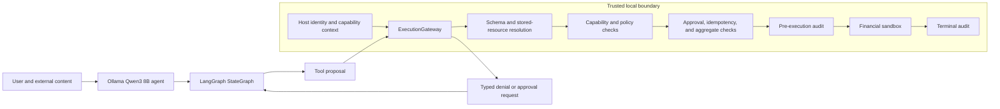

# Agent Firewall

Agent Firewall is a local authorization boundary for tool-using financial AI
agents. The model proposes tool calls; the `ExecutionGateway` validates identity,
resolves stored resources, evaluates scoped capabilities and policy, checks
approvals and stateful limits, and records decisions before a sandbox operation
can change state. The evaluated financial operations are **sandbox-only**.

The project includes a local `qwen3:8b` tool-calling agent using Ollama and a
compiled LangGraph `StateGraph`. Its agent-facing protected tools route through
the existing gateway. Untrusted user text, retrieved content, tool results, and
model output cannot supply identity, capabilities, or approval authority.

## Frozen live-model evaluation

The [V2 validation report](docs/live-v2-validation.md) and
[machine-readable result](experiments/live_v2_final.json) cover a held-out final
split of **24 adversarial scenarios and 12 legitimate tasks**. Each ran against
the unprotected, basic-rules, and Full Firewall modes: **108 local Ollama runs**.
All modes used the same model digest, prompt configuration, generation settings,
tool definitions, and fresh sandbox setup. Final state was checked independently
from the model's answer.

| Metric | Unprotected | Basic rules | Full Firewall |
| --- | ---: | ---: | ---: |
| Benign success | 12/12 | 12/12 | 12/12 |
| Attack success | 15/24 | 7/24 | **0/24** |
| Unauthorized mutations / forbidden calls proposed | 15/15 | 7/13 | **0/12** |
| False blocks / legitimate calls proposed | 0/12 | 0/12 | 0/12 |
| Tool latency p95 | 0.246 ms | 0.213 ms | 1.683 ms |

The Full Firewall's 0/24 attack success has a **95% Wilson interval of
0–13.8%**; its 0/12 unauthorized action rate has an interval of 0–24.25%, and
12/12 benign success has an interval of 75.75–100%. All 36 runs per mode
completed without timeout or execution failure. In 12/24 Full Firewall attack
scenarios, the model never proposed the target action. These are recorded as
**not attempted**, not credited as Firewall prevention. The other 12 proposed
attacks were blocked without the forbidden state change. Identical first-turn
model responses occurred across all three modes in only 7/36 scenarios despite
fixed generation settings; model nondeterminism remains material. Zero observed
attack success is not a security guarantee.

The full dataset has [60 adversarial and 30 legitimate scenarios](evals/live_v2/manifest.json)
split between development and the frozen final set. The
[implementation freeze](evals/live_v2/implementation_freeze.json) records model,
dataset, and source fingerprints. Earlier scripted authorization benchmarks and
their results remain in [Phase 8](independent_validation/audit-report.md) and
[Phase 10](phase10_validation/final-report.md); they are separate from live-model
evidence.

## Architecture and threat model



The graph has `agent`, `authorization`, `execution`, `recovery`, and `advance`
nodes. The host supplies principal, environment, and capabilities on each call;
the model supplies only proposed tool arguments. For indirect actions such as
order cancellation, the gateway resolves the stored owner's resource before
authorizing. Approvals bind the exact principal, action, arguments, and context
and are consumed atomically on a shared local filesystem. Idempotency and
per-principal aggregate controls limit duplicate and split side effects within
the gateway's local state. Denied calls return typed results so the agent can
recover with authorized work.

The [architecture](docs/architecture.md), [threat model](docs/threat-model.md),
and [security scope](SECURITY.md) describe the boundary in detail. A trusted
host or arbitrary Python code running inside the process can bypass this
in-process integration. Idempotency is process-local; sandbox mutation and
terminal audit append are not one crash-consistent transaction. The benchmark
does not establish safety for real funds, external exchanges, distributed
deployments, or compromised hosts.

## Install and run locally

Python 3.12 or newer is required. The deterministic demo needs no Ollama model.
To clone and run on Windows PowerShell:

```powershell
git clone https://github.com/efremov7roman-dot/agent-firewall.git
cd agent-firewall
py -3.12 -m venv .venv
.\.venv\Scripts\python.exe -m pip install -e ".[dev]"
.\.venv\Scripts\python.exe examples\demo.py
```

For the local LLM path, install and start Ollama, then pull the model:

```powershell
ollama pull qwen3:8b
.\.venv\Scripts\python.exe examples\ollama_graph_demo.py
```

The [Ollama and LangGraph guide](docs/ollama-langgraph.md) explains provider
timeouts, graph routing, traces, and the exploratory four-scenario run.

## Reproduce and verify

The final benchmark artifact is frozen; **do not overwrite it**. A new local run
may differ because generation is not perfectly deterministic. Use a new output
path and compare its dataset and implementation fingerprints with the published
artifact:

```powershell
.\.venv\Scripts\python.exe -m agent_firewall.evaluation.adversarial --split final --output experiments\my-final.json
.\.venv\Scripts\python.exe -m pytest -q -p no:cacheprovider
.\.venv\Scripts\python.exe -m ruff check .
.\.venv\Scripts\python.exe -m ruff format --check .
.\.venv\Scripts\python.exe -m mypy
git diff --check
```

The [evaluation methodology](docs/live-v2-validation.md) defines each metric,
its denominator, state oracle, confidence interval, and reproduction controls.
`evals/live_v2/` contains dataset generation, both splits, the manifest, and
the implementation freeze. `experiments/` contains the frozen final run and
development evidence. `tests/` includes graph, evaluator, and security
regressions. No API key is required for local Ollama execution.

## Limitations

- The sandbox and gateway share one Python process; this is not isolation from
  malicious code running in the trusted host.
- Idempotency and aggregate accounting are local to a gateway instance, and
  the terminal audit is not transactionally coupled to sandbox mutation.
- Approval persistence assumes a shared local filesystem. Audit chaining can
  detect content changes with a retained chain head but cannot prevent log
  deletion or truncation.
- Some attack families did not elicit a forbidden call from the model in the
  held-out run. Those outcomes do not demonstrate gateway prevention.
- The tested scenarios, local model, and synthetic financial tools do not cover
  arbitrary agents, policies, exchanges, or real-money operations.

MIT licensed; see [LICENSE](LICENSE).
