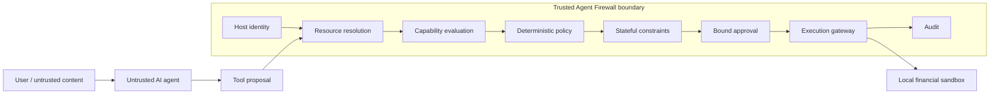

# Agent Firewall

**Zero-Trust Runtime Security for Tool-Using Financial AI Agents**

Agent Firewall treats every model-generated tool call as an untrusted proposal. A deterministic gateway—not the LLM—resolves resources, evaluates scoped authority, applies stateful constraints, verifies approvals, and records the outcome before a local financial sandbox can mutate state.

| Release evidence | Result | Scope |
| --- | ---: | --- |
| Successful attacks | **0/40** | Second frozen blind local evaluation |
| Unauthorized executions | **0/45** | Attempts in the same Phase 10 dataset |
| Benign workflows | **16/16** | Same Phase 10 dataset; 0/20 false blocks |
| Decision latency p95 | **0.0804 ms** | Hardened Phase 7 local rerun, 38 decisions |

These results support a scoped local authorization boundary. **0/40 does not mean universally secure**, and this project is not a production certification.

## Why this exists

Agents can reason about actions, but prompt instructions are not an authorization system. A model can be influenced by users, retrieved documents, tool output, or another agent. Agent Firewall separates LLM reasoning from deterministic authorization: the model proposes; trusted runtime policy decides.

## Architecture



The gateway is the supported agent-facing route to protected tools. It returns typed `ALLOW`, `DENY`, or `REQUIRE_APPROVAL` decisions and fails closed on validation, authorization, policy, or mandatory pre-execution audit errors.

## Security model

- Default deny and least-privilege capabilities scoped to agent, principal, environment, action, resource, amount, destination, and lifetime where applicable.
- Ownership-aware resource resolution prevents a caller from authorizing against its requested description of another principal's object.
- Exact-context approvals are principal/environment/action bound and consumed atomically on a shared local filesystem.
- Idempotency and per-principal aggregate controls constrain repeats and split actions.
- Audit records are redacted, deep-copied, and hash-chained to detect content changes.

These guarantees depend on a trusted host, identity context, policy configuration, and gateway integration. The hash chain detects modification; it does not prevent deletion or truncation.

## Example attack

A compromised agent proposes cancelling another principal's order. The gateway resolves the stored order before authorization, sees that its owner differs from the caller, and finds no delegated resource scope. It returns `DENY`, leaves sandbox state unchanged, and records the decision. The model's claim about ownership never becomes authority.

## Evaluation story

| Stage | Dataset | ASR | UAR | Benign |
| --- | --- | ---: | ---: | ---: |
| Initial development benchmark | 24 adversarial | 3/24 (12.5%) | 4/25 (16.0%) | 8/8 |
| First blind validation | 26 adversarial | 17/26 (65.4%) | 15/24 (62.5%) | 14/14 |
| Post-hardening regression | Same Phase 8 set | 3/26 (11.5%) | 2/24 (8.3%) | 14/14 |
| Second blind validation | 40 adversarial | 0/40 (0%) | 0/45 (0%) | 16/16 |

The datasets differ, so this is not a paired statistical experiment. Phase 7 was a development benchmark. Phase 8 independently exposed architectural weaknesses. Phase 9 reused those now-known cases and is regression evidence only. Phase 10 is the strongest post-hardening generalization evidence in this repository.

### What Phase 8 broke

The first blind review found that tool-level checks were not enough: principal/resource isolation was incomplete, approvals could replay across manager instances, cancellation scope and approval context were too weak, requests lacked idempotency, aggregate and destination constraints were absent, and audit guarantees were overstated. The failure is preserved because it drove the design forward.

### Hardened design

| Exposed root cause | Architectural defense |
| --- | --- |
| Shared or caller-described resources | Principal-owned state and stored-resource resolution |
| Cross-instance approval replay | Exact context binding and atomic local-file consumption |
| Duplicate and split actions | Idempotency plus stateful aggregate budgets |
| Unrestricted destinations | Capability destination allowlists |
| Mutable/incomplete audit evidence | Redaction, deep-copy isolation, chaining, fail-closed pre-audit |

See the [hardening design](docs/security-hardening/hardening-design.md) for engineering detail.

### Second blind validation

Phase 10 froze 40 new adversarial scenarios and 16 benign workflows before execution. Its dataset SHA-256 is `05af25ba7a7fe34122fa36ffbb3867de10032ace49b03b7c685ae1fb775ff841`. The first technically valid complete run produced 0/21 black-box and 0/19 gray-box successful attacks, 0/45 unauthorized executions, and 16/16 benign success. The invalid evaluator attempt is also preserved. Production code was frozen throughout.

## Local performance

| Measurement | p50 | p95 | p99 |
| --- | ---: | ---: | ---: |
| Hardened firewall decision (38 decisions) | 0.0385 ms | 0.0804 ms | 0.1082 ms |
| Direct policy (5,000 iterations) | 0.0052 ms | 0.0056 ms | 0.0059 ms |
| Gateway end-to-end (5,000 iterations) | 0.2392 ms | 0.3035 ms | 0.4995 ms |

The synthetic gateway profile measured 3,769.5 requests/second on its recorded local host. These are local deterministic measurements, not distributed-production claims.

## Quick start

Python 3.12 or newer is required. The core workflow needs no network, paid API, or secret.

```powershell
git clone https://github.com/efremov7roman-dot/agent-firewall.git
cd agent-firewall
py -3.12 -m venv .venv
.\.venv\Scripts\python.exe -m pip install -e ".[dev]"
.\.venv\Scripts\python.exe examples\demo.py
.\.venv\Scripts\python.exe -m pytest
.\.venv\Scripts\python.exe -m ruff check .
.\.venv\Scripts\python.exe -m ruff format --check .
.\.venv\Scripts\python.exe -m mypy
```

On macOS/Linux, activate the environment and replace the interpreter path with `.venv/bin/python`.

## Two-minute demo

```powershell
.\.venv\Scripts\python.exe examples\demo.py
```

The deterministic output shows an allowed market read, a denied unauthorized withdrawal, a high-risk action requiring approval, the exact approved execution, a safe idempotent replay with no second mutation, an unauthorized approver rejection, and an indirect-injection proposal denied by normal authorization.

## Repository structure

```text
src/agent_firewall/       runtime, policy, gateway, sandbox, and evaluation code
tests/                    unit, integration, property, and security regression tests
examples/demo.py          deterministic reviewer demo
experiments/              Phase 7 and Phase 9 machine-readable evidence
independent_validation/   frozen Phase 8 blind evaluation and reproduction
phase10_validation/       frozen second blind evaluation and reports
docs/                     architecture, threat model, evaluation, and portfolio material
```

## Reproducibility and evidence

The [evaluation guide](docs/evaluation.md) maps every headline metric to a machine-readable artifact. Useful checks include:

```powershell
.\.venv\Scripts\python.exe -m agent_firewall.evaluation --final --output-dir experiments\reproduction --seed 42
.\.venv\Scripts\python.exe -m independent_validation.runner --fingerprint
```

Phase 10's first valid result is intentionally immutable in place; its runner refuses to overwrite `phase10_validation/results.json`.

## Limitations

- Scripted proposals isolate authorization behavior; live-model semantic influence was not evaluated.
- Capability-valid malicious intent can still be harmful when trusted policy does not encode the user's mandate.
- Aggregate and idempotency state are local, not coordinated across hosts.
- Approval persistence assumes a shared local filesystem.
- Sandbox mutation and terminal audit append are not one crash-consistent transaction.
- Audit chaining detects content modification but cannot prevent deletion or truncation.
- The trusted host constructs identity and other security context.
- A malicious trusted host, compromised identity provider/administrator, real exchange, real money, and externally anchored audit storage are out of scope.

## Documentation

- [Architecture](docs/architecture.md)
- [Threat model](docs/threat-model.md)
- [Evaluation and claim-to-artifact map](docs/evaluation.md)
- [Phase 8 independent report](independent_validation/audit-report.md)
- [Phase 9 regression results](docs/security-hardening/regression-results.md)
- [Phase 10 final report](phase10_validation/final-report.md)
- [Portfolio summary](docs/portfolio-summary.md)
- [Evidence-backed resume metrics](docs/resume_metrics.md)
- [Interview guide](docs/interview-guide.md)
- [Security scope and reporting](SECURITY.md)

## License

MIT. See [LICENSE](LICENSE).
